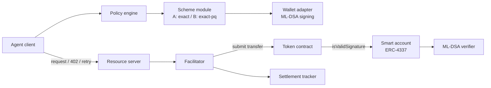

# quantum-agent-payments

Post-quantum authorization for AI-agent payments over [x402](https://www.x402.org).

> **Status: design phase.** Nothing here is audited or production-ready. Testnet and local chains only. Every capability claim is tracked in [`CAPABILITIES.md`](CAPABILITIES.md) with an evidence label.

## The problem

AI agents increasingly pay for APIs and services using x402, an HTTP-native payment protocol. Payment authorizations are signed with classical elliptic-curve cryptography, which a large quantum computer could eventually forge. Long-lived agent accounts and long-retention payment records are the first places this matters.

## The approach

Keep x402 unchanged and move the post-quantum check into the payer's smart account.

- **Option A (primary):** the agent's ERC-4337 smart account authorizes the standard x402 `exact` payment with an ML-DSA signature, wrapped in the ERC-1271 signature bytes x402 already carries for smart wallets. The token calls the account's `isValidSignature`, and an on-chain verifier checks ML-DSA. No x402 message formats change.
- **Option B (fallback):** a new scheme (provisionally `exact-pq`) carrying the ML-DSA signature explicitly, used only if Option A fails its viability gates.

The decision rule is in [`docs/adr/0001-option-a-vs-b.md`](docs/adr/0001-option-a-vs-b.md).

## Architecture at a glance



Components and the full payment flow are described in [`docs/02-architecture/`](docs/02-architecture/).

## What is and is not post-quantum

| Link | Post-quantum? |
|---|---|
| Agent payment authorization (ML-DSA via smart account) | Yes, if the full verification path is correct |
| Facilitator transaction submission | No (ECDSA) |
| Chain consensus signatures | No |
| x402 payment receipts (classical by default) | No |

This project does **not** claim the whole system is quantum-safe. See [`docs/04-security/`](docs/04-security/).

## Viability gates for Option A

| ID | Question | Status |
|---|---|---|
| A1 | Does the token route smart-account signatures to `isValidSignature`? | Unverified |
| A2 | Does the facilitator accept an ML-DSA ERC-1271 signature of this size? | Unverified |
| A3 | Does the payment header fit within header size limits? | Unverified |
| A4 | Is on-chain ML-DSA verification gas acceptable? | Estimated, not measured |
| A5 | Does a working ML-DSA account and verifier exist on a testnet? | Unverified |

Details and evidence: [`CAPABILITIES.md`](CAPABILITIES.md).

## Roadmap

- [ ] **M1** Verify the stack and fill the capability matrix
- [ ] **M2** Spikes A1 to A5 on a local chain, then a public testnet
- [ ] **M3** Decision record: proceed with A or switch to B
- [ ] **M4** Finalize architecture, threat model, and API specs for the chosen option
- [ ] **M5** First vertical slice: one agent paying one endpoint on a testnet

## Repository layout

```
docs/
  02-architecture/   context, component and sequence diagrams
  03-protocols/      x402, ERC-4337, ML-DSA verifier notes
  04-security/       threat model and trust assumptions
  adr/               architecture decision records
  research/          spike results and related work
spikes/              throwaway experiments for the viability gates
src/                 added only after the gates pass
CAPABILITIES.md      verified vs documented vs unverified claims
```

## Principles

1. x402 is never forked. Quantum support is added around it.
2. Smallest change first. Fall back only when evidence requires it.
3. Every claim carries an evidence label.
4. Honest security claims: we say what is and is not post-quantum.
5. No real funds. Throwaway keys only, never committed.

## Related work

See [`docs/research/related-work.md`](docs/research/related-work.md). Existing work covers post-quantum credentials and receipts for x402 and on-chain ML-DSA verification designs. This project focuses on the payment authorization path and a tested compatibility matrix.

## Contributing and security

See `CONTRIBUTING.md` and `SECURITY.md`. Do not report vulnerabilities in public issues.

## License

MIT. See `LICENSE`.
