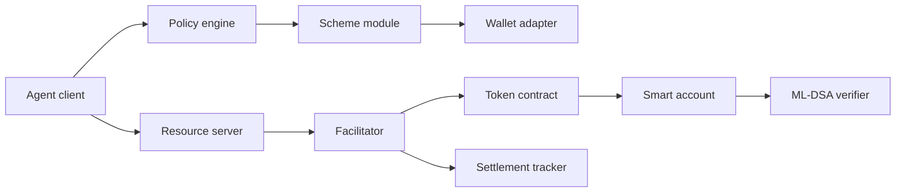
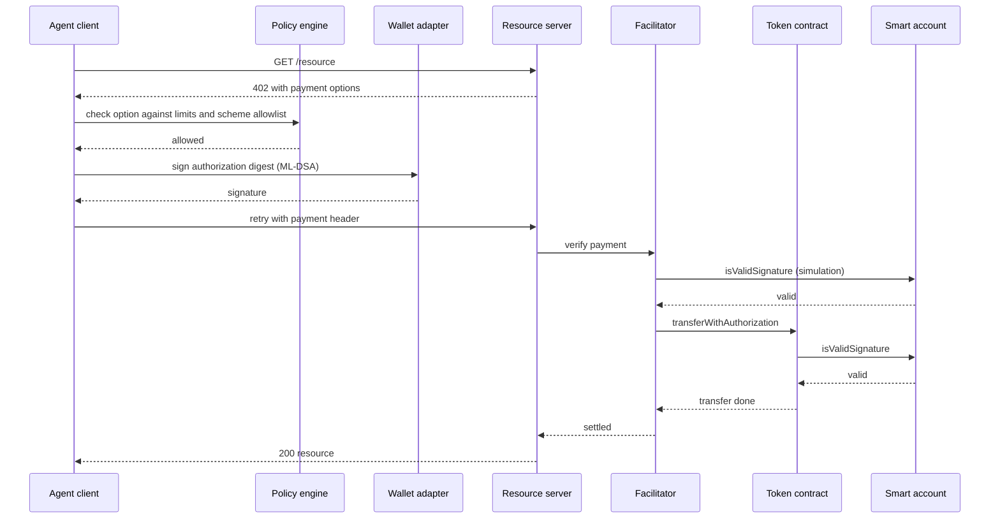

# Architecture: agent payments with post-quantum authorization

Status: Draft v0.1, 26 October 2026. Design only, no code yet.

Evidence labels: **Documented** (stated in a primary source, not tested by us), **Unverified** (needs a spike), **Planned** (our design choice). See [`CAPABILITIES.md`](../../CAPABILITIES.md).

## 1. Purpose and scope

This document defines how an AI agent pays for an x402-protected service using a smart account that authorizes payments with ML-DSA. It covers the primary design (Option A), the fallback (Option B), the conditions that trigger the fallback, and the security model.

In scope: the x402 payment flow, smart-account signing, facilitator verification, settlement tracking, spending policy.
Optional module: ERC-8004 identity and reputation.
Out of scope: mainnet deployment, real funds, production key custody, a new token.

## 2. Design principles

1. x402 is the base protocol and is never forked.
2. Smallest change first. Option A changes no x402 message formats.
3. One seam. Switching from A to B touches only the scheme module and the facilitator verifier.
4. Claims need evidence labels.
5. Honest security claims: say which links are post-quantum and which are not.
6. Testnet and local chains only until the design is validated.

## 3. Option A in one paragraph

The agent's smart account stores an ML-DSA public key. The agent signs the standard x402 `exact` payment authorization (the EIP-3009 typed-data digest) with ML-DSA, wrapped in the ERC-1271 signature bytes that x402 already carries for smart wallets. The facilitator submits the transfer. The token calls the account's `isValidSignature`, and the account's verifier checks the ML-DSA signature on-chain. To x402 this looks like an ordinary smart-wallet payment.

Evidence: x402 documentation lists deployed ERC-4337 accounts as supported for `exact` (Documented). Whether it works with an ML-DSA account is Unverified.

## 4. Components

| Component | Responsibility | Does not |
|---|---|---|
| Agent client | Calls services, handles the 402 challenge, retries with payment | Hold keys |
| Policy engine | Allows or rejects a payment: per-call cap, daily budget, allowed services, scheme allowlist | Sign |
| Wallet adapter | One interface to the wallet: sign a digest, report key and scheme info | Know about x402 |
| Quantum Wallet (or substitute) | Holds the ML-DSA key and signs | Speak HTTP |
| Scheme module | Builds the payload for the chosen scheme (A: `exact`, B: `exact-pq`) | Make policy decisions |
| Resource server middleware | Issues the 402 challenge, forwards payment to the facilitator, serves the resource | Verify signatures itself |
| Facilitator | Verifies, simulates, submits, reports | Judge service quality |
| Smart account (ERC-4337) | Owns funds, exposes `isValidSignature`, stores the ML-DSA public key | Hold the private key |
| Verifier contract | Verifies ML-DSA on-chain | Store funds |
| Token contract | Executes the transfer when the signature is valid | Know about quantum |
| Settlement tracker | Records state, confirmations, reconciliation | Move funds |
| ERC-8004 module (optional) | Identity lookup, reputation read, feedback write | Take part in payment |

## 5. Payment flow (Option A)

Only the signing step, the signature wrapping, and the `isValidSignature` checks differ from a standard smart-wallet x402 payment.

## 6. Signature envelope (Planned)

The ERC-1271 signature bytes are opaque to x402 and the token, so we define an envelope inside them:

- `version` (1 byte)
- `scheme_id` (1 byte): ML-DSA-44, ML-DSA-65, and so on
- `signature`: the ML-DSA signature
- optional `key_ref` for key rotation

FIPS 204 sizes: ML-DSA-44 signature 2,420 bytes, ML-DSA-65 signature 3,309 bytes. Base64 adds about one third. This matters for HTTP header limits (gate A3).

Open points: the context string used when signing, and whether the account verifies over the 32-byte digest directly. Decide in an ADR after reading the verifier.

## 7. Viability gates

| ID | Assumption | Test | Status |
|---|---|---|---|
| A1 | Token accepts the bytes-signature form and routes smart accounts to `isValidSignature` | Local chain with the token | Unverified |
| A2 | Facilitator accepts an ML-DSA ERC-1271 signature without gas or length limits | Local, then hosted on testnet | Unverified |
| A3 | Payment header fits within client, proxy, and server limits | Real payloads through common stacks | Unverified |
| A4 | Verification gas is acceptable | Measure on a local chain | Estimated (72x to 190x ECDSA) |
| A5 | A working ML-DSA account and verifier exist on a testnet | Read contracts, send a UserOperation | Unverified |
| A6 | ERC-6492 counterfactual accounts work (optional) | Spike | Unverified |

## 8. Option B: the fallback

Trigger: A1, A2, or A3 fails and cannot be fixed by configuration, or A4 shows unacceptable cost for every target use case.

B adds a scheme, provisionally `exact-pq`, where the payload carries the ML-DSA signature, key reference, and account details explicitly, plus a facilitator verifier plugin. It does not change the policy engine, wallet adapter, settlement tracker, or resource-server flow.

Negotiation: the server lists accepted schemes in the 402 response and the client picks the first one its policy allows. During migration a server may list both.

Cost of B: a custom facilitator and client. Hosted facilitators will not understand the scheme.

## 9. Security model

See [`../04-security/threat-model.md`](../04-security/threat-model.md).

## 10. Milestones

1. M1: verify the stack, fill `CAPABILITIES.md`
2. M2: spikes A1 to A5, local then testnet
3. M3: decision ADR: A or B
4. M4: finalize architecture, threat model, API specs
5. M5: first vertical slice on a testnet

## 11. Open questions

- Does Quantum Wallet exist as described, with public contracts and a testnet deployment?
- Which token and network give the best chance for A1?
- ML-DSA-44 or ML-DSA-65?
- Verifier precompile, Solidity implementation, or deferred verification?
- How closely to align with the existing IETF drafts on post-quantum x402?
- ERC-8004 module in v1 or later?
